# Архитектура ноды

Карта того, как устроена нода и как через неё проходят соединение,
сообщение и пробуждение устройства. Документ обзорный: нормативное
поведение на проводе описано в [server-contract.md](../server-contract.md),
формат — в схемах [`schemas/`](../schemas/). Расхождение между этим
документом и контрактом — ошибка этого документа.

Большинство разделов открывает иллюстрация из [`diagrams/`](diagrams/).
Она показывает одну главную мысль и сознательно упрощена. Точные условия
и ветки — в тексте раздела и в подробной схеме на
[Mermaid](https://mermaid.js.org/) под иллюстрацией: схема текстовая,
правится вместе с кодом, GitHub рисует её прямо в просмотре файла. Где
иллюстрации нет, Mermaid стоит открыто.

---

## 1. Система целиком

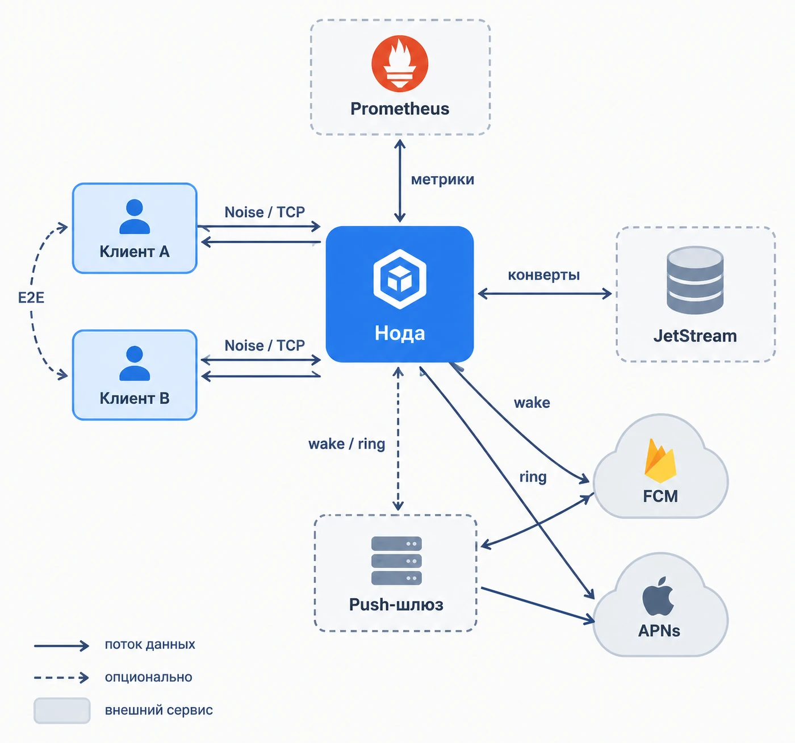

- Клиенты говорят с нодой по TCP. Канал шифрует Noise, TLS не
  используется. Identity клиента — его Ed25519-ключ, паролей и токенов в
  протоколе нет.
- Ключ ноды клиент получает до первого подключения, от оператора
  (паттерн IK), либо узнаёт в ходе хендшейка и решает, доверять ли ему
  (XX, TOFU).
- Недоставленное лежит в `sled` (бэкенд по умолчанию) или в потоке NATS
  JetStream (`DELIVERY_BACKEND=jetstream`).
- Файлы (медиа) не идут через ящик получателя: клиент загружает
  шифротекст в хранилище блобов ноды по отдельной сессии роли `BLOB`, а в
  сообщении передаёт только E2E-указатель на файл (раздел 2,
  [server-contract.md](../server-contract.md) §6.11).
- Push работает в одном из двух режимов: локальные креды FCM и APNs на
  ноде либо внешний push-шлюз, у которого креды владельца приложения.
  Смешивать режимы нельзя — это ошибка старта. Подробности —
  [push-gateway.md](push-gateway.md).

Подробная схема (Mermaid)

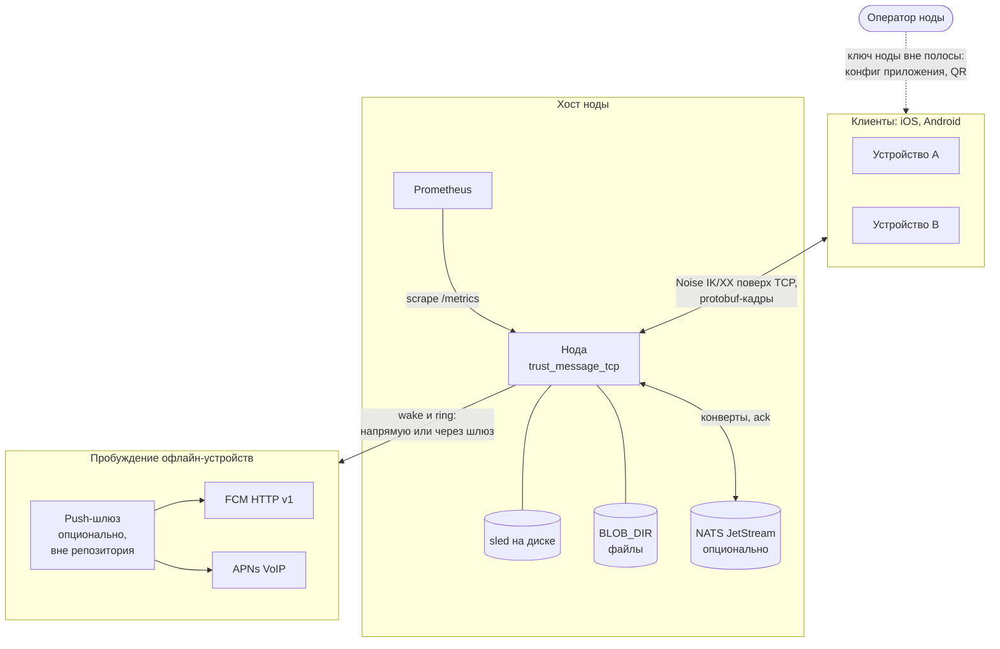

## 2. Компоненты ноды

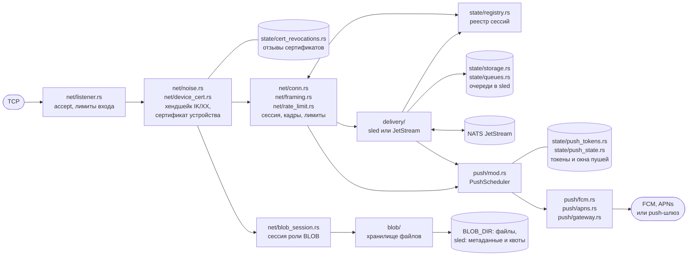

- Пути на схеме — относительно `src/`.
- Каждое соединение обслуживает отдельная задача tokio. Она проводит
  хендшейк и дальше читает и пишет шифрованный кадровый поток.
- **Реестр сессий** — общая карта `пользователь → список сессий`. В
  записи — `deviceId` сессии и канал на запись в её сокет, до 1024
  кадров. Отправка ищет в реестре цели и кладёт кадр в их каналы.
- **DeliveryBackend** выбирается конфигурацией. Прямой бэкенд пишет
  каждый принятый конверт в очередь `sled` и уведомляет живые сессии;
  запись снимает `DeliveryAck` (раздел 6.1). Брокерный публикует всё в
  JetStream, а выдают конверты пулы доставки (раздел 6.2).
- **Хранилище файлов** — отдельный путь. Байты файлов ходят только по
  второму соединению клиента, сессии роли `BLOB`: так сообщения и звонки
  не ждут за мегабайтами. Файлы лежат в `BLOB_DIR`, их метаданные,
  сроки и квоты — в `sled`. Сессия `BLOB` входящих не получает и
  устройство «в сети» не делает.
- **PushScheduler** — отдельная задача с ограниченной очередью триггеров:
  путь доставки на пушах не блокируется.
- Остальные модули (`config.rs`, `observability.rs`, `src/domain/`) —
  в таблице [структуры репозитория](../README.md#структура-репозитория).

## 3. Слои протокола

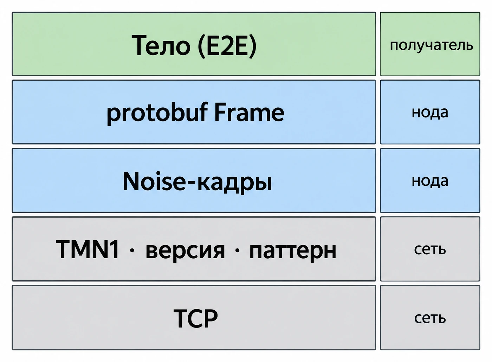

- **TCP** и **префикс** `TMN1` · версия · паттерн видны в сети. Префикс
  идёт открытым текстом, но входит в prologue Noise (раздел 5).
- **Noise-кадры** — транспортные сообщения Noise с длина-префиксом. Канал
  снимает нода: у каждого клиента он свой.
- **protobuf `Frame`** — `wire.v1.Frame`: версия протокола и `oneof` из
  33 типов кадров. Словарь кадров —
  [server-contract.md](../server-contract.md) §3, правила эволюции схемы —
  [protocol-schema.md](protocol-schema.md).
- **Тело** `ClientSend.body` / `IncomingMessage.body` и содержимое
  файлов — E2E-шифротекст клиентов. Нода переносит и хранит его как есть
  и не разбирает.

## 4. Соединение: от TCP до сессии

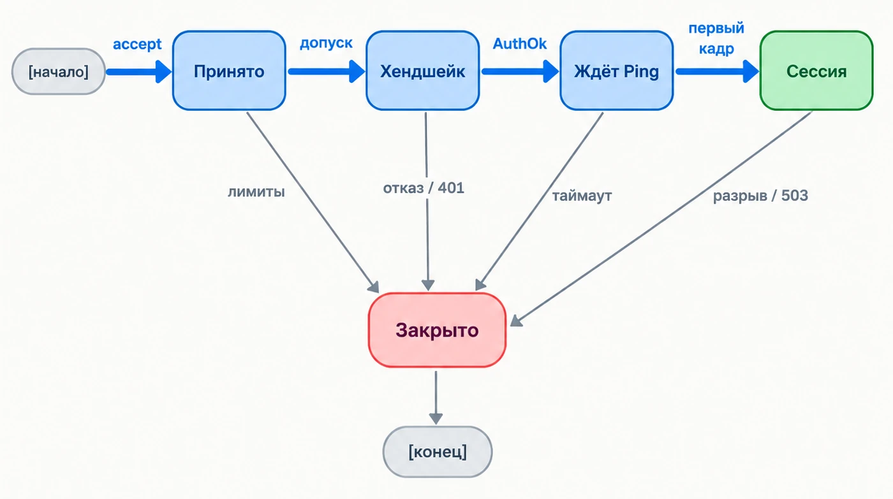

- **Принято.** Соединение сверх `LIMIT_MAX_CONNECTIONS` закрывается сразу
  после `accept`. Дальше нужен допуск на хендшейк: не больше
  `LIMIT_HANDSHAKE_INFLIGHT` одновременно на ноду и
  `LIMIT_HANDSHAKE_INFLIGHT_PER_IP` с одного адреса.
- **Хендшейк.** Отказ — разрыв TCP без диагностики: не та магия или
  версия, неизвестный паттерн или роль сессии, XX при
  `NOISE_ALLOW_TOFU=false`, чужой статик ноды, `identityKey` не совпал со
  статиком, ключ малого порядка, таймаут. Лимит сессий пользователя
  проверяется до `AuthOk`: вместо него приходит `AuthError 401`.
  Отозванный сертификат устройства получает `AuthError 403`.
- **Ждёт подтверждения** (на иллюстрации — «Ждёт Ping»). После `AuthOk`
  нода ничего не доставляет и не считает соединение онлайн-устройством.
  Сессию открывает первый кадр клиента, обычно `Ping`: прислать
  расшифровываемый кадр может только владелец эфемерного ключа
  хендшейка. Так переигранный msg1 IK не получает ни сессии, ни
  сообщений. Без кадра соединение закрывается через
  `SESSION_CONFIRM_TIMEOUT_SECS`.
- **Сессия.** Сессия попадает в реестр, после чего начинает дочитывать
  свои очереди (прямой бэкенд) или поднимаются пулы доставки
  (JetStream). Сессия роли `BLOB` в реестр доставки не попадает.
  Закрывается разрывом, `AuthError 503` (доставка недоступна),
  `AuthError 403` (сертификат отозван посреди сессии), истечением
  сертификата устройства или, на прямом бэкенде, когда сессия не успевает
  читать.

Подробная схема (Mermaid)

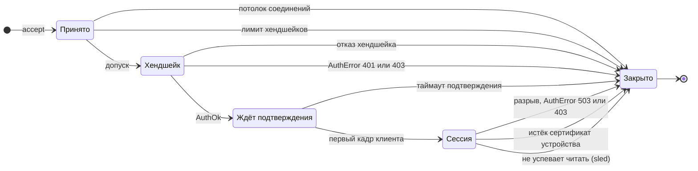

## 5. Хендшейк

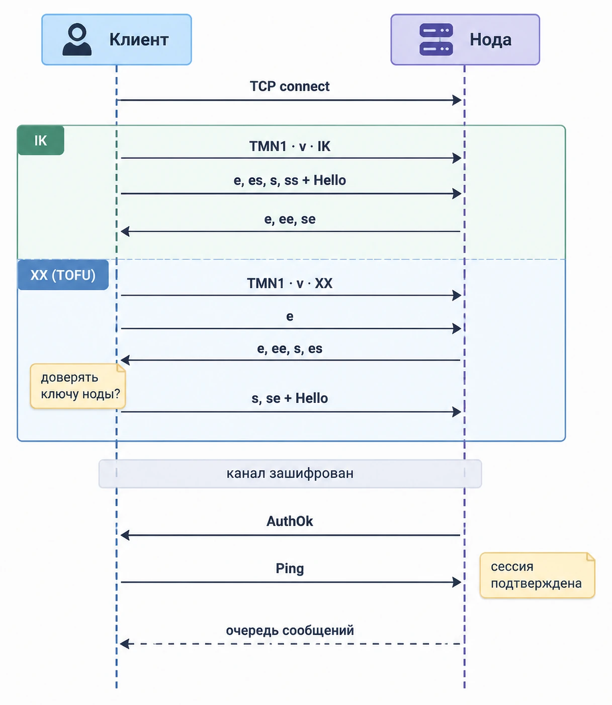

- Магия `TMN1`, версия протокола и байт паттерна идут открытым текстом, но
  входят в prologue Noise. Подмена любого из них разводит transcript'ы
  сторон, и хендшейк не сходится. Так закрыты downgrade версии и
  переключение клиента с пином на TOFU-путь.
- `NoiseClientHello` (на иллюстрации — «Hello») несёт `identityKey`,
  `deviceId`, роль сессии и, при делегированном входе, сертификат
  устройства. Роль лежит внутри зашифрованного payload, поэтому подменить
  её на проводе нельзя. Нода конвертирует `identityKey` в X25519 и
  сверяет с аутентифицированным статиком. При входе по сертификату статик
  сверяется с `deviceCert.transportKey`.
- Payload msg1 в IK зашифрован на статик ноды без её эфемерала и потому
  не имеет forward secrecy. Транспортная фаза forward secrecy имеет.
- Ключ ноды — один Ed25519-seed. Из него выводятся X25519-статик для
  Noise и ключ подписи `SignedServerConfig` и запросов к push-шлюзу, так что
  пиннить клиенту нужно одну величину. Обращение с ключом —
  [runbook-node-key.md](runbook-node-key.md).

Подробная схема (Mermaid)

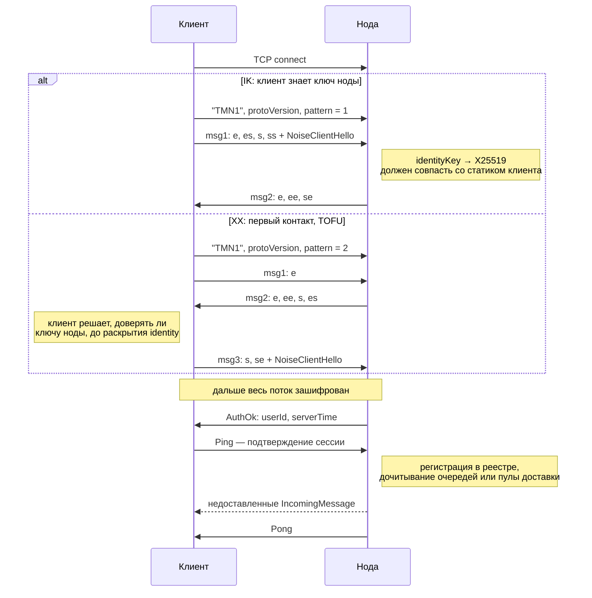

## 6. Доставка сообщения

Обе ветки начинаются одинаково. Нода принимает `ClientSend` и
проверяет его в фиксированном порядке:
1. разрешение `queueId`, если включена адресация по очередям;
2. пол `ttlSeconds`;
3. rate-limit отправителя.

Получатель — `recipientId` или владелец очереди. Account-scope сообщение
(без `recipientDeviceId`) уходит во все сессии пользователя, device-scope —
только сессиям этого устройства. Дальше ветки расходятся.

### 6.1. Прямой бэкенд (`sled`)

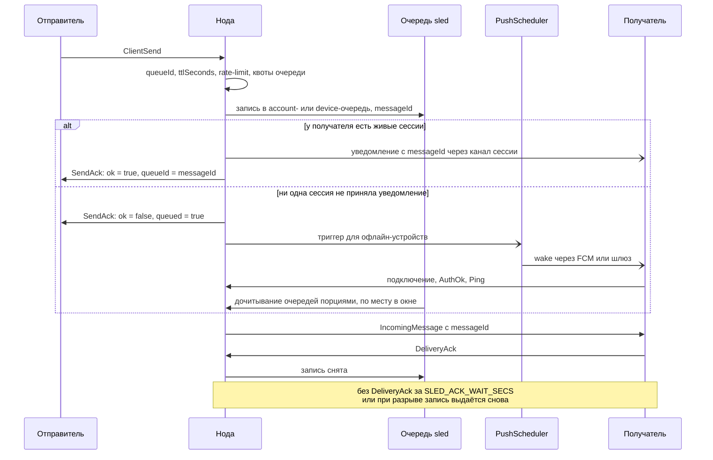

- Очередь — источник правды. Конверт пишется в очередь получателя при
  приёме, и для живого получателя тоже; сессии уходит только уведомление
  с `messageId` записи. Запись снимает `DeliveryAck`, а не запись в сокет:
  гибель клиента между чтением и подтверждением, разрыв с уведомлениями в
  канале, выписка сессии ничего не теряют — запись дочитается следующей
  сессией.
- Области подтверждения — как у брокерного бэкенда. Account-запись
  подтверждает любая сессия пользователя, запись устройства — только
  сессия этого устройства. Чужую запись не подтвердить: ключ строится от
  получателя сессии.
- Каждая сессия держит окно отданных и неподтверждённых записей
  (`SLED_MAX_UNACKED_PER_SESSION`, по умолчанию 1024 — как
  `max_ack_pending` брокера). Полное окно сессию не выписывает: выдача ждёт
  подтверждений, запись лежит в очереди, отправитель получает обычный
  `SendAck`.
- При подключении каждая сессия читает свои очереди с начала: первая
  порция — до ответа на подтверждающий кадр, остальное — в цикле сессии,
  вперемешку с подтверждениями. Читает каждая сессия, а не только первая
  у пользователя: вторая сессия аккаунта получает неподтверждённое первой,
  как получила бы его онлайн.
- Запись, не подтверждённая за `SLED_ACK_WAIT_SECS` (по умолчанию 30 с), в
  живой сессии выдаётся той же сессии снова. Сессия, ушедшая с
  неподтверждённым, будит остальные сессии пользователя перечитать
  очереди.
- Повторы по умолчанию не ограничены (`SLED_MAX_DELIVERIES=0`), как у
  брокера: запись живёт до подтверждения или конца хранения.
  Ненулевой `SLED_MAX_DELIVERIES` — ручка для клиентов без `DeliveryAck`:
  выдача с этим номером последняя и удаляет запись после записи в сокет
  (`1` — прежнее «удалить после записи»), исчерпание видно в
  `sled_delivery_given_up_total`. Только для старых клиентов без `DeliveryAck`; с клиентами trust_utils небезопасно (предел может удалить конверт, который клиент ещё обработает). Если всё же ставить — не ниже 10: клиентский карантин `UNACKED_REDELIVERY_LIMIT=5` сбрасывается при каждом переподключении.
- Неудачной считается только выдача, про которую доказано, что живой
  клиент её не подтвердил, а не «не успел обработать». Доказательство —
  клиент подтвердил выданное позже (обработка идёт по порядку, значит,
  этот конверт он отверг; «позже» — по первой выдаче записи в сессии,
  повтор номер не меняет) либо любой кадр клиента после выдачи — но
  только у сессии, которая не прислала ни одного `DeliveryAck` за всю
  жизнь и прожила больше трёх `ack_wait` (клиент без подтверждений, а не
  клиент, который ещё обрабатывает первый конверт и пингует). Полуоткрытый
  сокет (телефон пропал без FIN) кадров не шлёт и неудач не копит; при
  уходе сессии неудачей считаются только записи раньше последней
  подтверждённой — необработанный хвост короткого фонового пробуждения
  предел не расходует.
- Keepalive не срабатывает, пока нода пишет в сокет, поэтому принятые
  сокеты получают `TCP_USER_TIMEOUT` (`TCP_USER_TIMEOUT_SECS`, 120 с —
  четыре `ack_wait`): полуоткрытый сокет, в который идут повторы,
  рвётся, и неподтверждённое уходит следующей сессии, а не висит за
  мёртвой до таймаута ретрансмиссий (~15 мин).
- Повторная выдача никого не будит: пуш порождает только приём конверта
  без живой сессии получателя.
- Квоты очереди (`QUOTA_*`) действуют на любой приём, в том числе для
  живого получателя: очередь меряет неподтверждённое, и не подтверждающая
  сессия иначе копила бы записи без предела. Под-квота пары
  отправитель→получатель считается суммарно по account- и всем device-
  очередям (SEC-43); её счётчик пересобирается из очередей при старте,
  уменьшается при ack/удалении и не удерживается протухшими записями.
  Для живого получателя под-квота поднята на окно
  неподтверждённых (`SLED_MAX_UNACKED_PER_SESSION`): честный быстрый поток
  одного отправителя не упирается в неё до первого `DeliveryAck`, но и не
  занимает всю очередь медленного получателя. Упёршаяся квота
  даёт `SendAck` с `FULL` (`queue_full_total{path}`), вердикт помнится
  секунду: полная очередь не сканируется на каждый приём.
- Сессия, которая не успевает писать в сокет (переполнен канал
  уведомлений), выписывается из реестра и закрывается; её записи остаются
  в очереди.
- `SendAck.ok` значит «уведомление принято живой сессией», а
  `ok = false, queued = true` — «принято в очередь»; в обоих случаях
  `queueId` — `messageId` записи.
- Снятая по подтверждению запись уходит в архив `meta`, как раньше
  уходила доставленная из офлайн-очереди. С 0.4.0 через очередь идёт и
  онлайн-трафик, поэтому в архив попадает шифротекст всех доставленных
  конвертов; срок архива по умолчанию сокращён до 7 суток
  (`DELETED_MESSAGES_RETENTION`), `instant` выключает архив.
- `SendAck` уходит после записи в sled, но до сброса на диск: sled
  сбрасывает буферы фоновым флашером раз в ~500 мс. Аварийное падение
  ноды теряет записи последнего интервала, уже подтверждённые
  отправителю `SendAck`; штатная остановка делает flush.
- Снимок живых сессий получателя для уведомления берётся после записи в
  очередь: сессия, зарегистрированная позже снимка, найдёт запись своим
  дочитыванием при подключении.
- `OFFLINE_MESSAGES_RETENTION=instant` выключает хранение: конверт идёт
  только в живую сессию с `messageId = 0`, подтверждать нечего, и нода
  объявляет `supportsDeliveryAck = false`.
- Модель — at-least-once, как у брокера: дубликаты штатны, протокольного
  флага «повторная выдача» нет, клиент дедуплицирует по `messageId` и по
  идентификатору внутри шифротекста.
- Отличие от брокера: нет общего на scope пула. Окно и сроки живут в
  задаче сессии, сессии одного пользователя общаются через очередь и
  сигнал «перечитай очереди». Account-запись, отданная двум сессиям, по
  истечении срока выдаётся каждой из них, а не одной.

### 6.2. Брокерный бэкенд (JetStream)

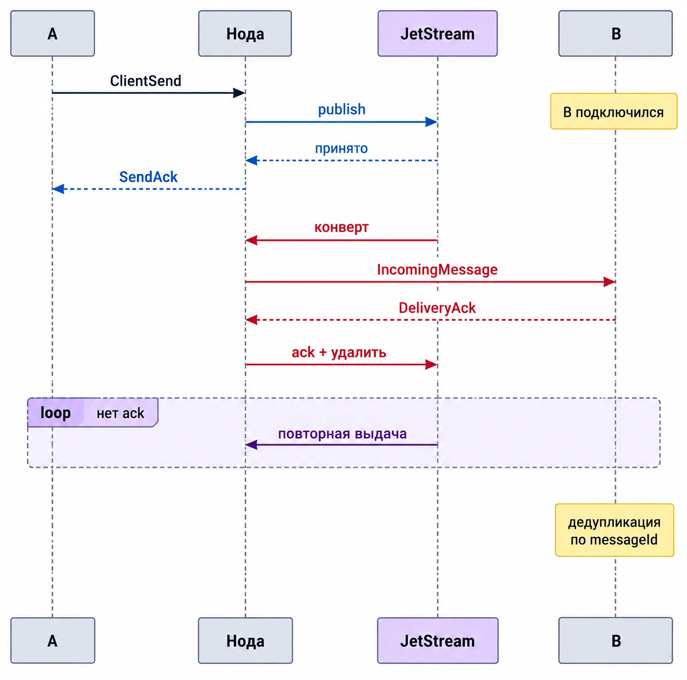

- Принятый конверт отправитель видит как `SendAck ok = true,
  queued = true, queueId = messageId`. Ящик или поток при переполнении
  отвечает `ok = false, reason = FULL`.
- Если у получателя есть устройства без живой сессии, публикация
  порождает для них триггер пуша.

Подробная схема (Mermaid)

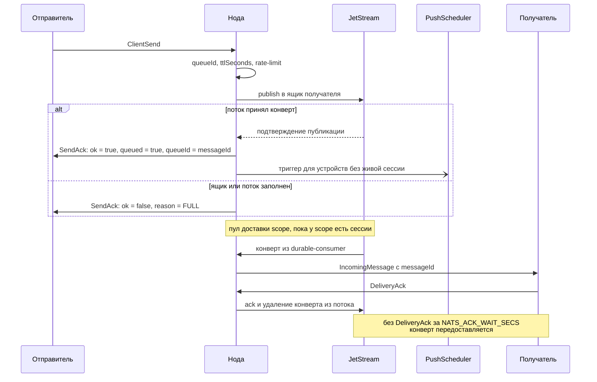

Ящики и пулы доставки:

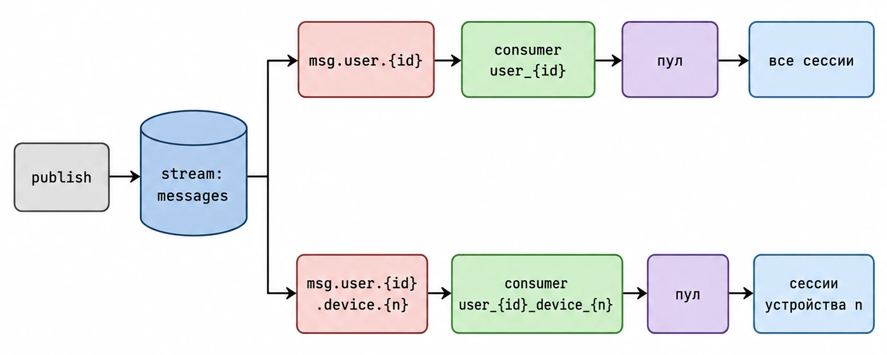

- У каждого ящика свой durable pull-consumer. Пул доставки поднимается
  при подтверждении первой сессии scope и завершается, когда scope уходит
  в офлайн. Неподтверждённые конверты завершившегося пула сразу
  возвращаются потоку.
- Пул ждёт место в канале сессии и сессии не выписывает.
- `DeliveryAck` снимает конверт, только если его прислал получатель этого
  scope. Account-scope конверт закрывается первым подтверждением от любой
  сессии пользователя.
- Поток работает по политике `discard: new`. Заполненный ящик
  (`NATS_MAX_MSGS_PER_SUBJECT`) или поток (`NATS_STREAM_MAX_BYTES`)
  отвечает новому конверту `FULL`, уже принятые не вытесняются. Лимиты
  считают только недоставленное.
- Модель — at-least-once. Дубликаты штатны, клиент дедуплицирует по
  `messageId` и по своему идентификатору внутри шифротекста
  ([server-contract.md](../server-contract.md) §6).
- Пуш порождают публикация и первая выдача обычного конверта пулом, если
  устройство успело уйти в офлайн. Передоставка не будит, звонковый
  конверт будит только публикация.

Подробная схема (Mermaid)

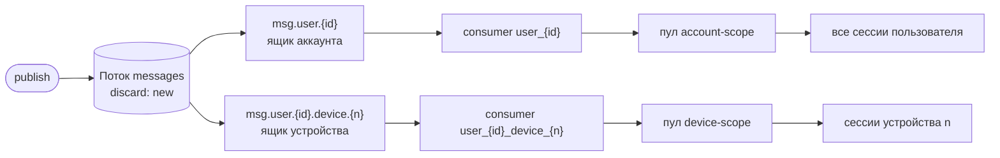

## 7. Пробуждение устройств

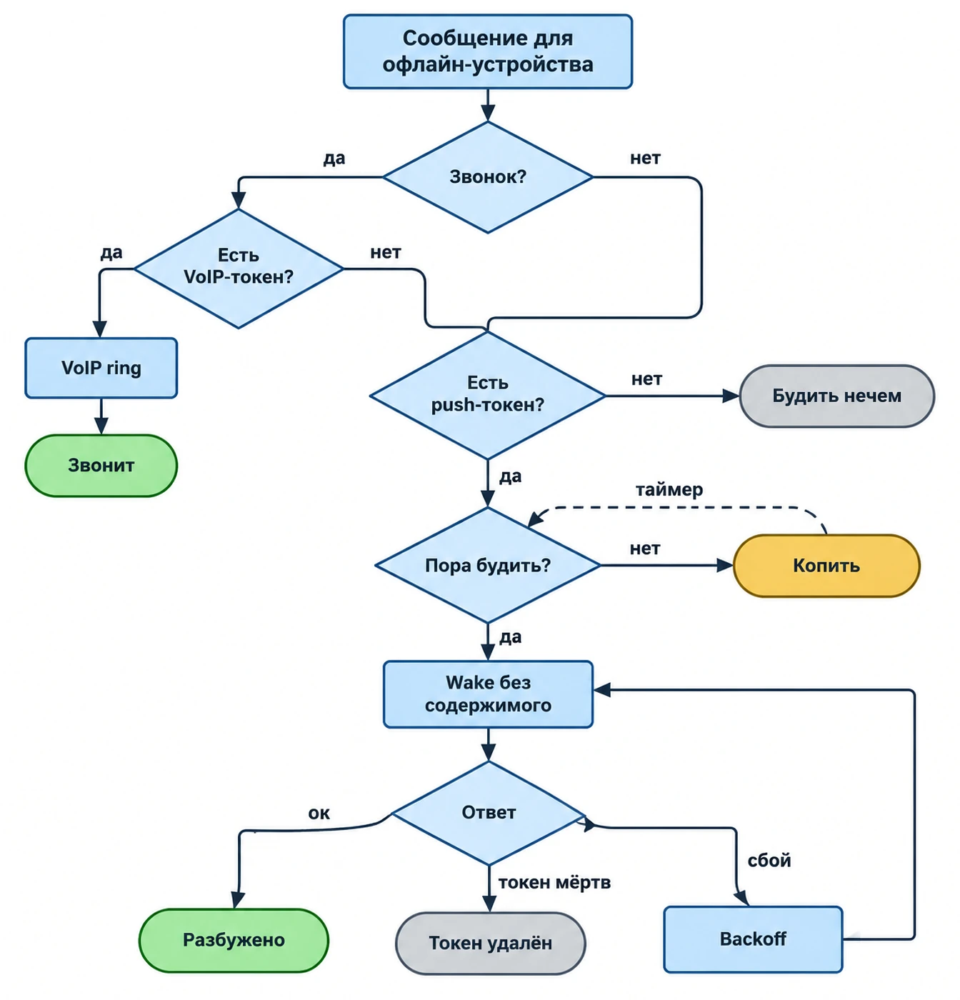

- Пуш получают только устройства без живой подтверждённой сессии. Сессия
  без `deviceId` ни с каким токеном не сопоставляется и пушей не
  подавляет. Сессия роли `BLOB` пушей тоже не подавляет.
- Триггеры идут через ограниченную очередь (`PUSH_CHANNEL_CAPACITY`): путь
  доставки на ней не ждёт, а при переполнении триггер отбрасывается и
  учитывается в метриках.
- «Пора будить» — порог по максимальному приоритету накопленного:
  `PUSH_MIN_GAP_*_MS` — минимальный интервал между пушами,
  `PUSH_BURST_*` — сколько сообщений будят досрочно. Состояние окна лежит
  в `sled` и переживает рестарт.
- Звонок (`wakeHint = INCOMING_CALL`) идёт мимо коалесинга. Повторный ring
  тому же устройству в пределах cooldown подавляется. Если ring
  невозможен или не удался, звонок уезжает обычным wake с маркером
  `wake_hint = "call"`: только так о звонке узнаёт Android.
- Триггеры одного устройства обрабатываются строго по очереди, разных —
  параллельно. К провайдеру одновременно идёт не больше
  `PUSH_SEND_CONCURRENCY` обращений, это касается и wake, и ring.
- Payload пуша не содержит тела сообщения. Состав полей —
  [server-contract.md](../server-contract.md) §8.

Подробная схема (Mermaid)

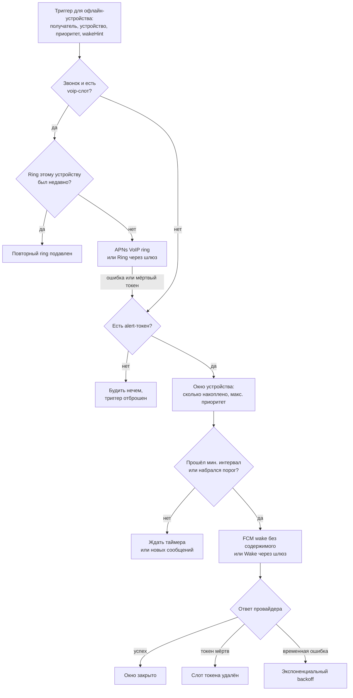

## 8. Развёртывание

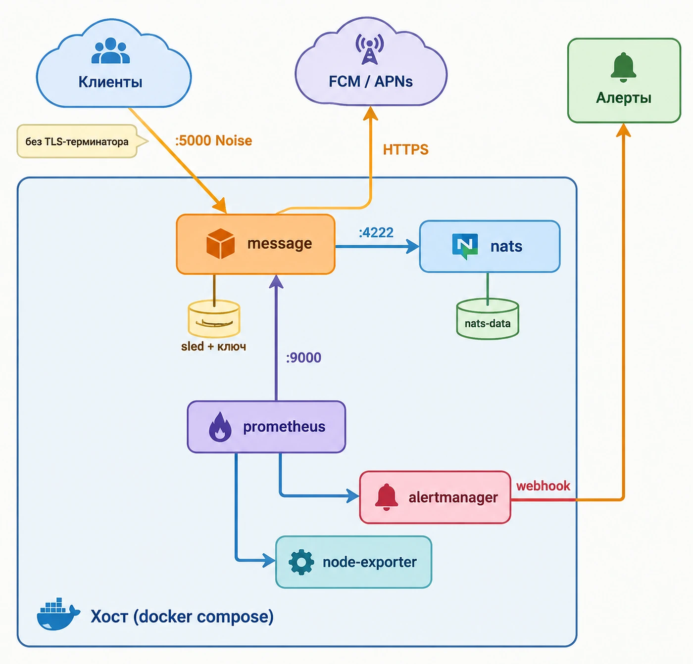

Прод-стек из [deploy/docker-compose.override.jetstream.yml](../deploy/docker-compose.override.jetstream.yml).

- Наружу открыт только порт протокола. Метрики, мониторинг NATS и
  Alertmanager слушают внутреннюю сеть или `127.0.0.1`: у экспортера метрик
  нет аутентификации.
- TLS-терминатор перед нодой ставить нельзя: он сломает Noise-хендшейк.
- Ключ ноды приходит из `NODE_IDENTITY_KEY` в `.env` рядом с compose.
  Без него деплой падает намеренно, а не генерирует новый ключ.
- Файлы хранилища лежат в `BLOB_DIR`, по умолчанию внутри тома данных
  (`<STORAGE_PATH>/blobs`), и в бэкап ноды не входят.
- Сборка, выкладка, бэкапы и откат — [deployment.md](deployment.md).

Подробная схема (Mermaid)

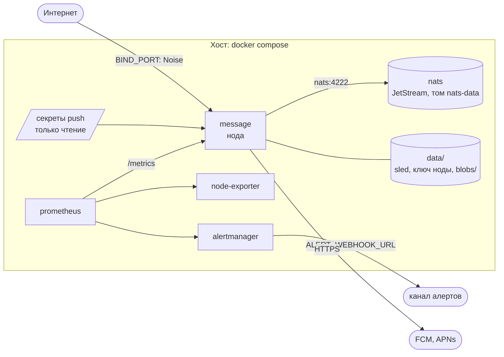

## 9. Кто что видит

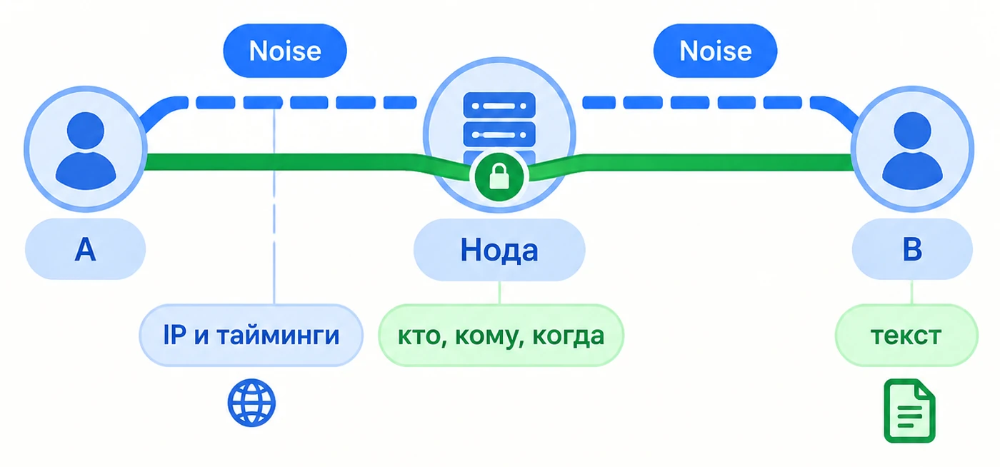

Тело сообщения шифруется дважды: E2E-шифрованием клиентов и Noise-каналом
каждого клиента до ноды. Нода снимает только второй слой.

| Сторона | Видит | Не видит |
|---|---|---|
| Наблюдатель в сети | IP, размеры и тайминги Noise-сообщений | Адресатов, `deviceId`, кадры, тела |
| Нода и NATS | Отправителя и получателя (`user_id`, `deviceId`), размеры, время, приоритет, признак звонка, IP клиентов; у файлов — размер, кто загрузил в чей ящик, срок. Всё это хранится в открытом виде; на прямом бэкенде шифротекст и метаданные подтверждённых конвертов ещё `DELETED_MESSAGES_RETENTION` лежат в архиве `meta` | Тело и содержимое файлов: это E2E-шифротекст |
| FCM, APNs | Push-токен, время пробуждений; в FCM wake — `user_id` и `deviceId` получателя | Тело, отправителя |
| Push-шлюз | Push-токен, время пробуждений, ключ ноды; в `Wake` — `user_id`, `deviceId`, число и приоритет накопленного | Тело, отправителя, размер сообщения |

Подробная схема (Mermaid)

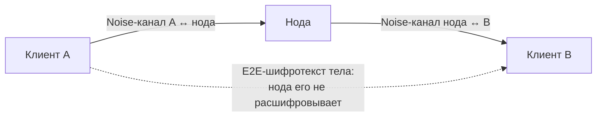

Подробно о модели угроз и ограничениях —
[README](../README.md#модель-безопасности) и
[server-contract.md](../server-contract.md) §12.
